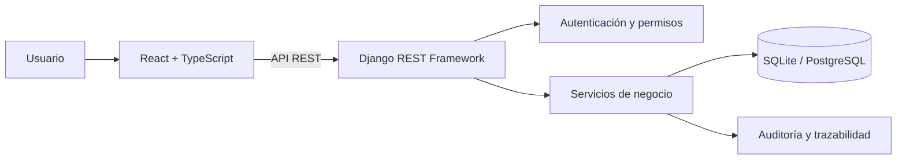

# Arquitectura

Nexo separa la interfaz de usuario de las reglas de negocio mediante una API REST.

## Decisiones

- **Dominios modulares:** cuentas, colaboradores, comercial, inventario, compras, ventas, documentos, importaciones y núcleo compartido.
- **Servicios de negocio:** las operaciones que coordinan varios registros se agrupan para validar reglas y aplicar transacciones.
- **Inventario trazable:** movimientos Kardex y operaciones explícitas; los cambios de stock no se delegan a señales automáticas de ventas.
- **Interfaz reutilizable:** tokens visuales, grillas y filtros comunes para reducir inconsistencias entre módulos.
- **Consultas en servidor:** paginación, filtros y exportaciones evitan transferir toda una tabla al navegador.
- **Idempotencia:** las operaciones que la implementan usan claves para reducir duplicaciones por reintentos. No implica que todos los endpoints sean idempotentes.

## Límites

SQLite permite una instalación local simple. No demuestra comportamiento bajo concurrencia en PostgreSQL. Tener roles, pruebas o auditoría tampoco sustituye una revisión de seguridad del despliegue. Los archivos cargados requieren políticas de almacenamiento y acceso verificadas.

Esta edición utiliza nombres y datos de ejemplo y se instala desde cero. No pretende migrar bases históricas.
